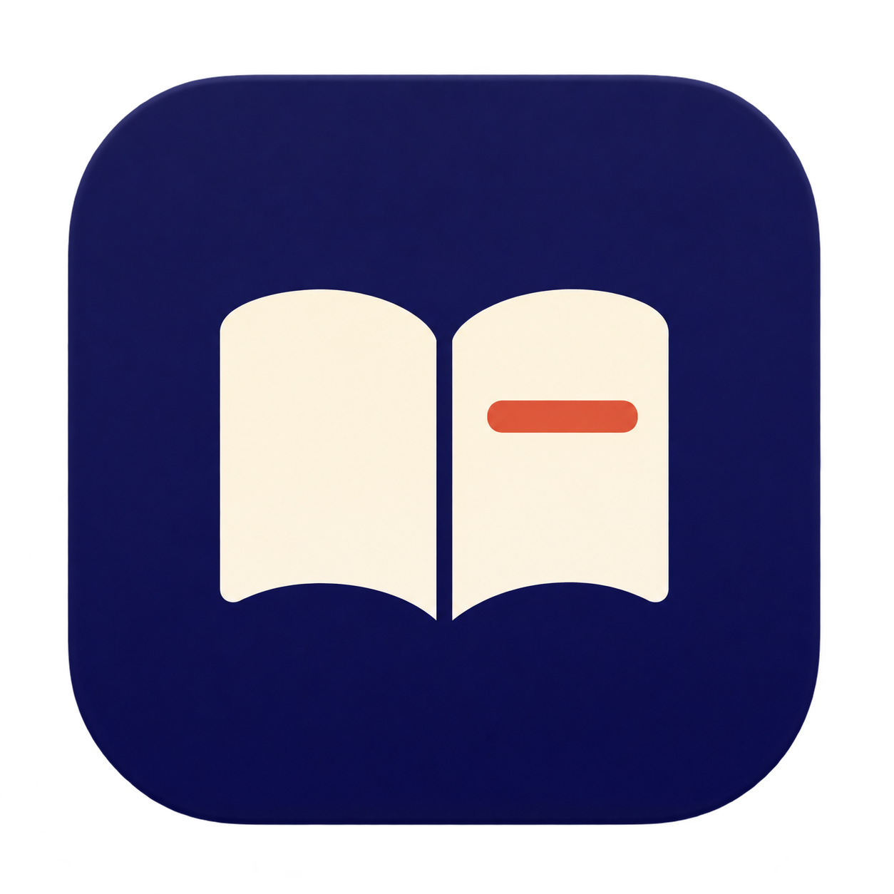

# 读解 · Yomitoki

**日语深度阅读。** 从词义到句子结构，再到围绕原文的追问，帮助你读懂日语书籍。项目名来自「読み解き」。

[下载最新版本](https://github.com/yizhiru/Yomitoki/releases/latest) · [更新记录](CHANGELOG.md)

## 平台与安装

| 平台 | 0.1.1 安装包 | 要求 |
| --- | --- | --- |
| macOS | `Yomitoki-0.1.1-macos-arm64.zip` | Apple Silicon，macOS 14+ |
| Windows | `Yomitoki-0.1.1-windows-x64-setup.exe` | Windows 10 / 11，64 位 Intel / AMD |

macOS 解压后将「读解.app」拖入「应用程序」；Windows 运行安装向导。安装包包含离线词典和翻译引擎，**不包含模型权重**。校验文件随 Release 提供。

当前安装包尚未进行 Apple 公证或 Windows 代码签名，系统可能提示确认来源。首次打开前，请确认文件来自本仓库的 Releases。

## 能做什么

- **阅读文档**：导入 PDF、EPUB、MOBI；Windows 另支持 UTF-8 TXT。保存书架、阅读进度、字号和分栏宽度。
- **单词释义**：离线英文与中文词义、词性、基本形归一；按需调用大模型补充语境释义与词源。
- **本地翻译**：选中日语句子或段落，使用 Hy-MT2-1.8B Q4 翻译成中文，原文留在本机。
- **长句分析**：拆解主干、修饰层级与语法难点，提供结构嵌套图。
- **选文对话**：结合所选文字及附近原文向大模型提问、继续追问，保存对话记录。
- **生词本**：按基本形收集词义和多条例句，搜索并导出 CSV / TXT。

## 开始使用

1. **导入书籍**：PDF 需有文字层；Windows 版已内置 EPUB / MOBI 正文解析；macOS 版仍需安装 [calibre](https://calibre-ebook.com/)。两端都不支持 DRM 正文。
2. **选中文字**：单词显示两种释义，完整句子显示翻译与长句分析，段落显示翻译；有效选区均可打开对话。单击自动查词默认关闭，复制使用系统快捷键。
3. **配置模型（可选）**：在「设置」填写 DeepSeek 或 OpenAI 兼容接口和自己的 API key；本地翻译需手动下载或选择约 1.13 GB 的 Q4 模型，支持 HF 镜像与 ModelScope。

选择文字不会自动请求模型。释义、分析和译文会缓存；远程功能按你的 API 账户计费。本地翻译引擎已内置，macOS 使用 Metal，Windows 0.1.1 起优先使用 Vulkan GPU，自动模式下失败回退 CPU。

Windows 提供「自动 / GPU / CPU」选项，使用方式与验证范围见 [Windows GPU 加速](docs/windows-gpu.md)。

详细说明：[macOS](docs/macos.md) · [Windows](docs/windows.md)。两端数据独立保存，暂不提供跨设备自动同步。

## 从源码构建

**macOS**：需要 Xcode / Command Line Tools（Swift、Python 3）。

```sh
./scripts/build.sh
./scripts/test.sh
open "dist/读解.app"
```

**Windows**：需要 Node.js 24 和 Python 3；终端用户安装已构建版本时无需这些工具。

```powershell
cd desktop
npm ci
npm run prepare:resources
npm test
npm run test:ui
npm run build:win
```

Windows 安装包输出到 `dist/windows/`。构建时校验固定版本的字典与 llama.cpp 引擎；模型权重不会随构建下载。Windows 安装与界面测试见 [GitHub Actions](.github/workflows/windows.yml)。

## 数据与署名

macOS 沿用 `~/Library/Application Support/Bunmyaku`，Windows 使用 `%APPDATA%\Yomitoki`，升级不会主动删除已有数据。API key 使用各系统的凭据存储或加密机制保存。

英文词典来自 [JMdict](https://www.edrdg.org/wiki/JMdict-EDICT_Dictionary_Project.html)，字典许可见 [Dictionary](Resources/Dictionary/SOURCES.txt)；翻译引擎来自 [llama.cpp](https://github.com/ggml-org/llama.cpp)，第三方许可随安装包提供。模型来源与许可见 [Hy-MT2](https://huggingface.co/tencent/Hy-MT2-1.8B-GGUF)。
